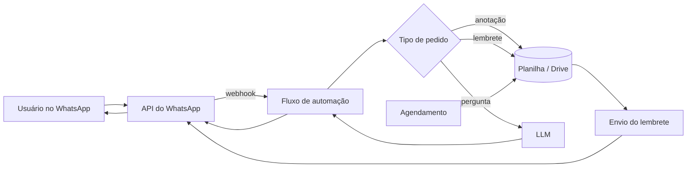

# Nath

Assistente de IA no WhatsApp que guarda anotações, agenda lembretes (para o próprio usuário e para outras pessoas) e responde dúvidas. Foi lançada antes do Meta AI chegar ao WhatsApp.

## Problema

Anotações e lembretes do dia a dia ficam espalhados entre apps que a pessoa esquece de abrir. Já o WhatsApp fica aberto o dia todo. Faltava um assistente que funcionasse ali, na conversa, sem instalar nada.

## Solução

- **Anotações:** o usuário manda uma mensagem e a Nath registra.
- **Lembretes:** agenda lembretes para o próprio usuário e para terceiros, que recebem o aviso no WhatsApp.
- **Perguntas:** dúvidas enviadas no chat vão para um LLM, e a resposta volta na mesma conversa.

## Como funciona

Detalhes em [docs/arquitetura.md](docs/arquitetura.md).

## Stack

- **Make**: orquestração dos fluxos (no-code)
- **Z-API**: integração com o WhatsApp
- **OpenAI API**: respostas às dúvidas
- **Google Sheets e Google Drive**: armazenamento de anotações e lembretes
- **Webhooks e APIs REST**

## Meu papel

Concebi e construí o produto sozinho: fluxos no Make, integração com o WhatsApp, estrutura de dados no Google e uso da OpenAI.

## Status e resultados

- Lançada **antes do Meta AI** chegar ao WhatsApp.
- Projeto exploratório, usado por mim e por um grupo de parceiros e amigos.
- Desativado: hoje o Meta AI cobre esse uso dentro do próprio WhatsApp.

## O que aprendi

- **Low/no-code tem custo:** acelerou a construção, mas o custo por uso das plataformas é maior do que o de uma solução própria.
- **Estar à frente do tempo não vende sozinho:** houve interesse, mas sem um público específico vendeu pouco. Hoje assistentes de IA no WhatsApp, como o Meta AI, são produtos grandes.
- **Oferta e venda valem mais do que a ideia e a construção em si**, e a velocidade decide muita coisa.

## Contato

[guilhermesint.gerencia@gmail.com](mailto:guilhermesint.gerencia@gmail.com) · portfólio [guilhermevictaliano.github.io](https://guilhermevictaliano.github.io) · LinkedIn [linkedin.com/in/guilherme-victaliano-de-meira-b73933343](https://www.linkedin.com/in/guilherme-victaliano-de-meira-b73933343)

---

## English

**Nath** is a no-code AI assistant that lives in WhatsApp, launched before Meta AI arrived there.
Users send a message to save a note, schedule a reminder for themselves or for someone else, or ask a question.
Questions go to the OpenAI API and the answer comes back in the same chat.
An exploratory project used by me, partners and friends; now retired, since Meta AI covers the same ground.
Built with Make, Z-API (WhatsApp), OpenAI, Google Sheets and Google Drive. Flows are private; demo on request.
