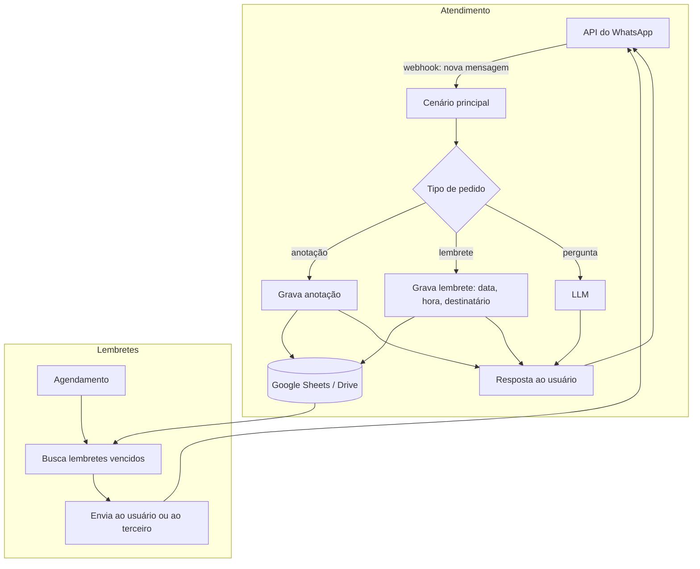

# Arquitetura: Nath

## Visão geral

Toda mensagem recebida no WhatsApp dispara um cenário no Make, que decide o tipo de pedido e o encaminha. Um segundo cenário, agendado, verifica os lembretes que venceram e os envia.

## O que é regra e o que é IA

| Etapa | Tipo |
|---|---|
| Receber a mensagem e responder | Regra (webhook + API do WhatsApp) |
| Gravar anotações e lembretes | Regra (Google Sheets / Drive) |
| Disparar lembretes no horário | Regra (agendamento) |
| Responder dúvidas | IA (OpenAI) |

## Decisões técnicas

- **WhatsApp como interface:** nada para instalar; o usuário já está lá.
- **Google Sheets como banco:** fácil de inspecionar e corrigir à mão, sem infraestrutura.
- **Make (no-code):** permitiu lançar rápido e iterar nos fluxos sem servidor próprio.
